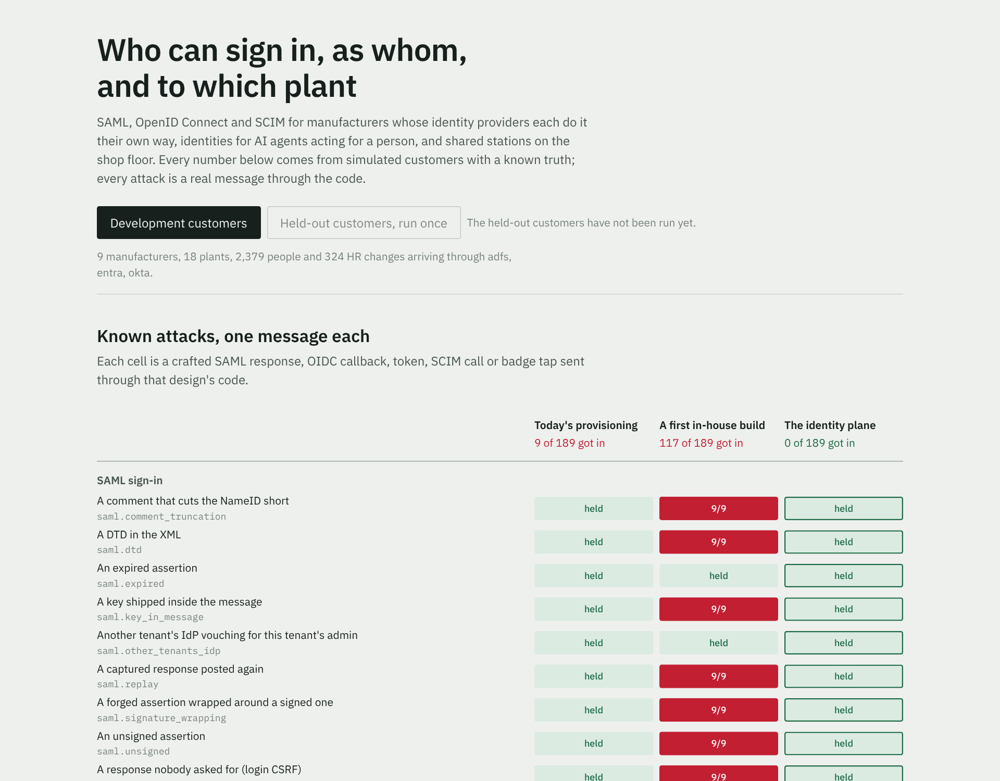

# frontline-identity-plane

Identity and access for a multi-tenant manufacturing platform. Customers' identity providers (Microsoft Entra, Okta,
ADFS, Ping) push people and groups over SCIM 2.0; people sign in with SAML or OpenID Connect; groups become roles in
plants through mapping rules a model proposes and code checks; AI agents act for a person through OAuth token
exchange with no more than that person may do; operators share stations with a badge. Every design is run on simulated
customers whose truth is known, and every known attack is a real message through the code.



## Why

A manufacturer's access has stakes a SaaS login does not: a leaver who can still sign a batch record, an operator who
cannot start their shift, a quality approval recorded under the wrong name. Customers' IdPs push SCIM in their own
dialects, group names are a mix of site codes, German and history, and AI agents now act for people. Most of the
damage happens in the gaps: a group that is not synced, a role an admin sets by hand and never removes, a SAML library
that verifies one element and reads another, an agent with a standing key.

TULIP's own documentation describes some of these gaps today: SCIM provisions users only and groups are not synced,
SAML users land as Viewer until an Account Owner changes their role by hand, and in IdP Control Mode a user can
belong to one workspace. This repository builds the layer that closes them and measures what that is worth.

## What the role asks for, and where it is

| The role asks for | Where it is |
|---|---|
| SSO with SAML 2.0 and OIDC, understanding the specs and their failure modes | `src/fip/protocols/saml.py`, `xmldsig.py`, `oidc.py`, `jose.py`: signature wrapping, comment truncation, key in the message, DTDs, replay, InResponseTo, audience, recipient, skew; PKCE, state, RFC 9207 mix-up defence, fixed algorithms per issuer. Each break has a test that it is refused and that it works with the one check off. |
| SCIM provisioning | `src/fip/protocols/scim.py`: Users and Groups, filters, PATCH including Entra's and ADFS-era quirks, PUT from Okta, ETags, 404 on unknown members, start and end dates |
| Multi-tenant account structures; tenant isolation as a hard requirement | the tenant comes from a credential, never a URL (`service/api.py`); cross-tenant attacks in the catalogue; `tests/test_boundaries.py` |
| The authorization layer | `src/fip/authz/engine.py`: one place that decides, from the IdP's current state, approved rules and manual grants; nothing stored in sessions |
| Identity for AI agents acting on a person's behalf | `src/fip/authz/agents.py`: RFC 8693 token exchange, down-scoped to the person, tenant-bound, minutes long, re-checked on every use |
| Security-critical systems where failure halts production | shift starts blocked, leaver hours, signatures under another identity, all measured (`src/fip/sim/run.py`) |
| AI tooling with a point of view | `src/fip/onboarding.py`: a model proposes group-to-role mappings; privileged roles go to a person and a name never decides alone. The repository was built with an AI coding agent working to AGENTS.md. |
| Shipping clean, tested code | 56 Python tests and 6 console tests, lint and types in CI, a container, a held-out lock |

## Results

<!-- results:start -->

_Generated by `python -m fip.cli report` from `reports/dev.json`. Do not edit by hand._

**Development customers:** 3 simulated sets of 3 manufacturers, 18 plants and 2,379 people in all, 6 weeks each, with 324 HR changes (joiners, leavers, transfers, promotions, temporary assignments, contractor ends) arriving through adfs, entra, okta. Every design meets the same people, the same changes, the same attacks and the same shop-floor days.

| | Today's provisioning | A first in-house build | The identity plane |
|---|---:|---:|---:|
| Attacks that got in | 9 of 189 | 117 of 189 | **0 of 189** |
| ... of them reaching another tenant | 0 | 9 | **0** |
| Hours from the IdP's deactivation to every access path closed, p95 | 0.57 | 815.18 | **0.17** |
| Person-hours with more access than the IdP gives | 20,245 | 47,447 | **15** |
| Person-hours with more access than HR intends (includes the IdP's own lag) | 22,102 | 51,676 | **418** |
| Shift starts where someone could not do their job | 123 | 408 | **7** |
| Access tickets to plant admins | 111 | 0 | **0** |
| Admin hours to connect the customers | 77.5 | 24.3 | **18.9** |
| AI-assistant actions the person was not allowed | 2,857 | 3,603 | **2** |
| ... beyond what the IdP said at that moment | 2,856 | 3,575 | **0** |
| AI-assistant requests refused although allowed | 1,857 | 33 | **3** |
| Station records under someone else's name | 89 | 6,684 | **89** |
| Signatures under someone else's identity | 0 | 3,070 | **0** |
| Signatures with the badge alone (no second component) | 0 | 22,151 | **0** |
| IdP changes the service refused and lost | 0 | 179 | **0** |
| Legitimate logins turned away | 0 of 360 | 0 of 360 | **0 of 360** |

**Known attacks, each a real message through the design's code:**

| Attack (attempts per design) | Today's provisioning | A first in-house build | The identity plane |
|---|:---:|:---:|:---:|
| `agent.scope_escalation` (9) | **9 in** | **9 in** | held |
| `agent.token_at_other_tenant` (9) | held | held | held |
| `jwt.alg_none` (9) | held | **9 in** | held |
| `jwt.expired` (9) | held | held | held |
| `jwt.hmac_with_public_key` (9) | held | **9 in** | held |
| `jwt.other_audience` (9) | held | held | held |
| `oidc.code_injection` (9) | held | held | held |
| `oidc.login_csrf` (9) | held | **9 in** | held |
| `oidc.mix_up` (9) | held | **9 in** | held |
| `saml.comment_truncation` (9) | held | **9 in** | held |
| `saml.dtd` (9) | held | **9 in** | held |
| `saml.expired` (9) | held | held | held |
| `saml.key_in_message` (9) | held | **9 in** | held |
| `saml.other_tenants_idp` (9) | held | held | held |
| `saml.replay` (9) | held | **9 in** | held |
| `saml.signature_wrapping` (9) | held | **9 in** | held |
| `saml.unsigned` (9) | held | **9 in** | held |
| `saml.unsolicited_login_csrf` (9) | held | **9 in** | held |
| `saml.wrong_audience` (9) | held | held | held |
| `scim.other_tenant_by_path` (9) | held | **9 in** | held |
| `station.leaver_badge` (9) | held | held | held |

Connecting the customers' IdPs: a model read 162 group names; code accepted 36 as rules (0 wrong) and sent the rest to a person: 18.9 admin hours, against 24.3 mapping every group by hand and 77.5 setting roles person by person today.

**What each safeguard is worth** (one changed at a time):

| Variant | Attacks in | IdP changes lost | Person-hours over HR's intent | Wrong grants from mapping | Assistant actions not allowed | Station records under another name |
|---|---:|---:|---:|---:|---:|---:|
| **The identity plane** | 0 | 0 | 418 | 0 | 2 | 89 |
| Identity plane that rejects the IdPs' quirks (spec-strict SCIM) | 0 | 179 | 18,505 | 0 | 2 | 89 |
| Identity plane that applies the model's mapping without checking the members | 0 | 0 | 397,538 | 9 | 39 | 89 |
| Identity plane that ignores the start and end dates the IdP sends | 0 | 0 | 5,161 | 0 | 28 | 89 |
| Identity plane whose agent tokens are not re-checked on use | 0 | 0 | 418 | 0 | 2 | 89 |
| Identity plane that gives agents the scopes they ask for | 0 | 0 | 418 | 0 | 2 | 89 |
| Identity plane whose station sessions do not lock | 0 | 0 | 418 | 0 | 2 | 6,717 |
| Identity plane that reads the first assertion, signed or not | 9 | 0 | 418 | 0 | 2 | 89 |

**Release gates, development customers:** all pass

| Gate | Value | Limit | |
|---|---:|---:|---|
| Attacks that got in | 0.000 | ≤ 0 | pass |
| Cross-tenant access | 0.000 | ≤ 0 | pass |
| Hours from IdP deactivation to the last access path closed, p95 | 0.170 | ≤ 1.0 | pass |
| Over-privileged person-hours, ratio to today | 0.019 | ≤ 0.25 | pass |
| Blocked shift starts, ratio to today | 0.057 | ≤ 0.25 | pass |
| Legitimate logins turned away, share | 0.000 | ≤ 0.005 | pass |
| Wrong grants applied from the model's mapping | 0.000 | ≤ 0 | pass |
| AI-assistant actions the IdP did not allow, ratio to today | 0.000 | ≤ 0.02 | pass |
| Signatures recorded under someone else's identity | 0.000 | ≤ 0 | pass |

<!-- results:end -->

## How it works

```
 customer IdP (Entra / Okta / ADFS / Ping)                       person, agent, station
   |  SCIM 2.0: users, groups, start/end dates                     |  SAML / OIDC / token exchange / badge
   v                                                               v
 scim.py  ---- tenant from token, quirks understood ---->  store per tenant
                                                               |
 onboarding.py: model proposes group -> (plant, role)          |      saml.py / oidc.py: read what was verified,
   code: privileged -> person; members must fit; else rule     |      issuer and key per tenant
                                                               v
                                    engine.py: decide(tenant, person, action, plant, now)
                                      from the IdP's current state + approved rules + manual grants
                                                               |
                    agents.py: token = person ∩ agent scopes, minutes, re-checked     stations.py: idle lock, PIN to sign
```

The designs compared:

- **Today's provisioning**, as documented: SCIM for users only, Viewer on first sign-in, roles set by an admin on a
  ticket, a standing API key for automations. Its protocol checks are modelled as equal to the identity plane's; this
  repository does not claim anything about TULIP's internals.
- **A first in-house build**: group sync with library-default checks, a spec-strict SCIM parser, long-lived agent
  tokens, stations without an idle lock.
- **The identity plane**, and one variant per safeguard.

## Run it

```bash
pip install -e ".[dev]"
pytest -q                            # a few seconds
python -m fip.cli run dev            # every design on the development customers, about two minutes
python -m fip.cli gate dev           # exit 1 if a release gate fails
python -m fip.cli report             # REPORT.md, this README's results, the console data
python -m fip.cli serve              # the API with a demo tenant
cd web && npm ci && npm run dev      # the console
```

## The service

| Call | What it does |
|---|---|
| `POST/GET/PUT/PATCH/DELETE /scim/v2/Users`, `/scim/v2/Groups` | SCIM 2.0 for the customer's IdP; the tenant comes from the bearer token |
| `GET /t/{tenant}/saml/login`, `POST /t/{tenant}/saml/acs` | SP-initiated SAML; returns the person and their grants |
| `GET /t/{tenant}/oidc/login`, `GET /t/{tenant}/oidc/callback` | OIDC code flow with PKCE, state and the `iss` parameter |
| `POST /oauth/token` | RFC 8693 token exchange for an agent acting for a person |
| `POST /t/{tenant}/authorize` | the product asks before every agent action; re-checked against the person's access now |
| `POST /stations/{id}/badge`, `POST /stations/{id}/act` | badge sign-in at a shared station; a signature needs the PIN |
| `GET /healthz`, `GET /metrics` | readiness and Prometheus counters |

## Limits

- **Everything about the customers is simulated**: people, HR changes, IdP behaviour, group names, the model that
  reads them, shift hand-overs and the attacks. The protocol code is real and runs on real messages.
- It is a portfolio project, built in my own time, not code I ran at an employer. It has not been through a
  penetration test or a SAML/OIDC certification.
- SAML covers the Web SSO profile with RSA-SHA256 and exclusive C14N; no encrypted assertions, no single logout,
  no metadata refresh. OIDC covers the code flow; no front-channel logout, no refresh tokens, no key rotation
  schedule. SCIM covers the subset real IdPs send; no bulk endpoint, no complex filters.
- State is in memory; a production service would keep SCIM data, rules and replay caches in a shared database.
- The residual 89 station records under another name are hand-overs within the 5-minute idle lock; only a badge
  tap per action would remove them, which the shop floor would not accept.
- AWS and Azure IAM for the product's own infrastructure is not part of this repository.

## Repository

```
config/      world.yml (simulated customers) · platform.yml · designs.yml · seeds.yml · gates.yml
src/fip/
  protocols/ saml, xmldsig, oidc, jose, scim: the specs and their checks
  authz/     model, engine, agents (token exchange), stations
  onboarding.py  the model proposes, code decides
  service/   the HTTP API
  world/     the simulated customers and their IdPs
  sim/       builds each design, runs the weeks, runs the attacks
  lab/       the study, gates, the held-out lock, reports
web/         the console (React, Framer Motion)
docs/adr/    decisions
```

MIT licence. Built by Manoj Kumar Prakash.
